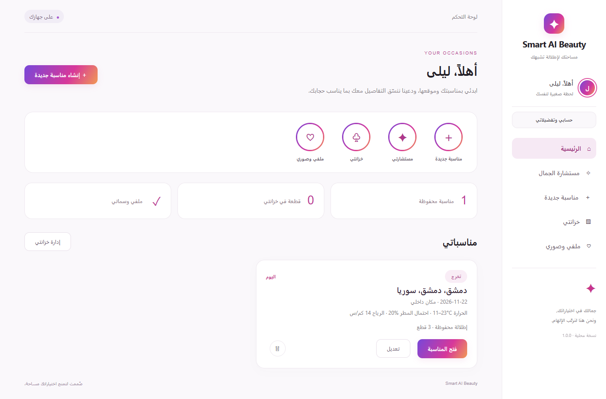

# Smart AI Beauty

مساعدة عربية (RTL) لتنسيق إطلالة المناسبة: تربط نوع المناسبة وموقعها وطقسها بخزانتك وسمات وجهك وجسمك، ثم تقترح إطلالة متكاملة وتتيح تجربة الشعر أو **لفة الحجاب** والمكياج وتوليد صورة تقريبية للإطلالة.

> مشروع تعليمي يعمل محلياً على جهازك. الإصدار الحالي **1.0.0**.



## المزايا

| الميزة | الوصف |
| --- | --- |
| إطلالات الحجاب | اختيار «إطلالة بالحجاب» من أول الملف أو عند إنشاء الحساب يحوّل خطوة الشعر إلى **8 لفات حجاب و8 ألوان**، ويعرض القطع المحتشمة، ويخصّص الاقتراحات والمحادثة وتوليد الصور. |
| تحليل السمات | استخراج محلي لمعالم الوجه والجسم (MediaPipe) يبدأ تلقائياً بعد حفظ الصورتين: شكل الوجه، توازن الكتفين والوركين، نسبة الجذع للساقين. |
| ملخص تنسيق مدروس | السمات تتحول إلى قواعد تنسيق ثابتة (قصات، لفة أو تسريحة، مكياج) تُعرض لكِ وتُرسل **كنص** للذكاء الاصطناعي ليبني عليها اقتراحه. |
| مناسبات وطقس | إنشاء مناسبة بتاريخ ومدينة، وجلب توقع الطقس من Open-Meteo، وعدّ تنازلي للموعد. |
| خزانتي | رفع صور ملابسك ووصفها؛ تبقى خاصة بحسابك وتدخل في الاقتراحات. |
| اقتراح الإطلالة | Gemini يختار قطعاً موجودة فعلاً من خزانتك والكتالوج، مع سبب كل قطعة. |
| مستشارة الجمال | محادثة نصية محصورة بالجمال والأزياء، تعرف سياق مناسبتك وملخص سماتك. |
| معاينات محلية | مكياج ولون شعر على صورتك داخل المتصفح دون إرسال الصورة. |
| توليد الصور | تجربة التسريحة أو لفة الحجاب وصورة الإطلالة الكاملة عبر Cloudflare Workers AI، بعد موافقة صريحة. |
| حفظ تلقائي | اختيارات الإطلالة تُحفظ تلقائياً مع المناسبة، مع تنزيل لوحة PNG وملف JSON. |

## التشغيل

المتطلب الوحيد: [Node.js](https://nodejs.org/) **22.11 أو أحدث**. لا توجد اعتماديات npm.

```bash
git clone <repository-url>
cd smart-ai-beauty
npm start
```

ثم افتحي <http://127.0.0.1:3000/>. على Windows يمكن النقر المزدوج على `start.cmd`، أو على `Smart AI Beauty.bat` الذي يشغّل الخادم في الخلفية ويفتح المتصفح.

### مفاتيح خدمات الذكاء الاصطناعي

التطبيق يعمل دون مفاتيح (الحسابات، الخزانة، المعاينات المحلية، تحليل السمات). الاقتراحات والمحادثة وتوليد الصور تحتاج مفاتيح توضع في `runtime/.env` — مجلد `runtime/` مستبعد من Git:

```bash
mkdir runtime
cp .env.example runtime/.env   # ثم املئي القيم
```

| المتغير | الاستخدام |
| --- | --- |
| `GEMINI_API_KEY` و`GEMINI_MODEL` | اقتراح الإطلالة ومستشارة الجمال |
| `CLOUDFLARE_ACCOUNT_ID` و`CLOUDFLARE_API_TOKEN` | توليد الصور (FLUX.2 klein 4B) |
| `OLLAMA_URL` و`OLLAMA_MODEL` مع `AI_PROVIDER=ollama` | بديل نصي محلي تجريبي |
| `PORT` | منفذ الخادم (الافتراضي 3000) |

المفاتيح تبقى على الخادم ولا تصل إلى المتصفح.

## الاختبارات

```bash
npm test
```

23 اختباراً آلياً تعمل دون إنترنت ودون مفاتيح (الخدمات الخارجية مستبدلة بمحاكاة): عزل الحسابات، الجلسات، الحجاب وتوليد التعليمات، ملخص السمات، الحصص، التخزين المؤقت، والمسارات. تفاصيل ما اختُبر يدوياً وفي المتصفح في [docs/VERIFICATION.md](docs/VERIFICATION.md).

## بنية المشروع

```text
server.mjs            خادم HTTP وجدول المسارات (REST API + الملفات الثابتة)
adapters/             منطق الخادم: الحسابات، المناسبات والخزانة، Gemini، Cloudflare، الطقس
public/               الواجهة: HTML/CSS/JavaScript دون إطار عمل أو خطوة بناء
  options.js            مصدر واحد للخيارات (تسريحات، لفات حجاب، ألوان…) مشترك مع الخادم
  appearance-features.js استخراج السمات وملخص التنسيق، مشترك مع الخادم
  vendor/mediapipe/     نماذج MediaPipe المضمنة للعمل محلياً
tests/                اختبارات Node Test Runner
docs/                 التوثيق والمراجع ولقطات الشاشة
legacy/               تجربة try-on سابقة متوقفة، محفوظة للمرجع فقط
runtime/              قاعدة البيانات والمفاتيح (لا تُرفع إلى Git)
```

شرح التدفقات والأحداث بين الوحدات في [docs/ARCHITECTURE.md](docs/ARCHITECTURE.md).

## الخصوصية والحدود

- الصور والخزانة والمحادثات محفوظة محلياً في `runtime/accounts.sqlite`. كلمات المرور مجزأة بـscrypt، والبيانات على القرص غير مشفرة: لا تشاركي مجلد `runtime`.
- Gemini يستقبل **نصاً فقط**: المناسبة، الطقس، التفضيلات، ملخص السمات وأوصاف القطع. لا تُرسل له الصور ولا البريد.
- الصور تُرسل إلى Cloudflare فقط عند ضغط زر التوليد بعد الموافقة.
- تحليل السمات تقدير هندسي تقريبي من صورة واحدة: ليس قياسات ملابس ولا تقييماً للجسم، ويمكن تصحيحه يدوياً من «حسابي وتفضيلاتي».
- الصور المولدة تقريبية وقد تغيّر الملامح أو تفاصيل الملابس.
- الخادم يستمع على `127.0.0.1` فقط. النشر على الإنترنت يحتاج مراجعة إضافية (HTTPS، تشفير البيانات، شروط الخدمات المجانية).

## التوثيق

| الملف | المحتوى |
| --- | --- |
| [docs/ARCHITECTURE.md](docs/ARCHITECTURE.md) | البنية والتدفقات وواجهات API |
| [CHANGELOG.md](CHANGELOG.md) | تغييرات كل إصدار |
| [docs/APPEARANCE_AND_MODESTY.md](docs/APPEARANCE_AND_MODESTY.md) | السمات وتفضيلات الحجاب والاحتشام |
| [docs/CLOUDFLARE_INTEGRATION.md](docs/CLOUDFLARE_INTEGRATION.md) | ربط محرك الصور |
| [docs/PROJECT_REFERENCE.md](docs/PROJECT_REFERENCE.md) | مرجع تاريخي لقرارات الإصدارات 0.x |
| [THIRD_PARTY.md](THIRD_PARTY.md) | المصادر والتراخيص (MediaPipe، Fashionpedia، Open-Meteo) |

## الترخيص

لم يُحدَّد ترخيص للمشروع بعد؛ أضيفي ملف `LICENSE` قبل جعل المستودع عاماً. مكونات الطرف الثالث تخضع لتراخيصها المذكورة في [THIRD_PARTY.md](THIRD_PARTY.md)، وصور عينة Fashionpedia للاستخدام التعليمي ولا تُفترض لها حقوق تجارية.
